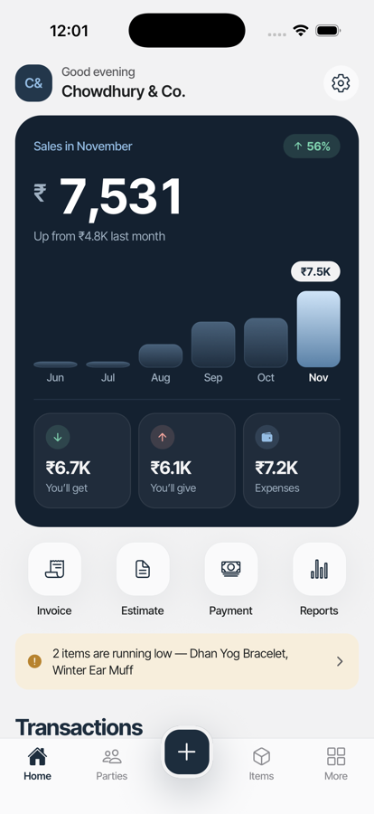
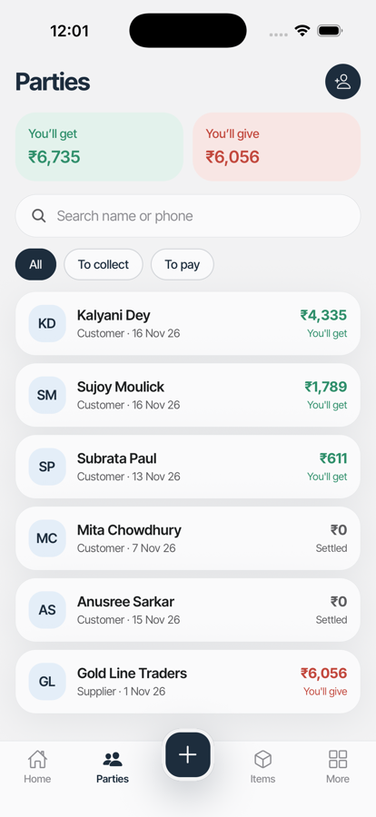
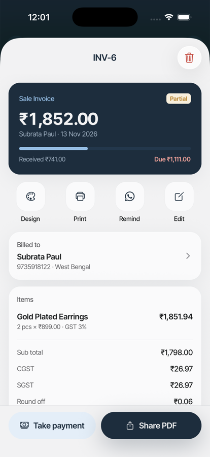
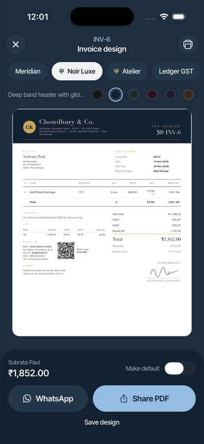
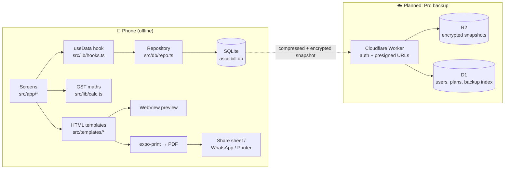
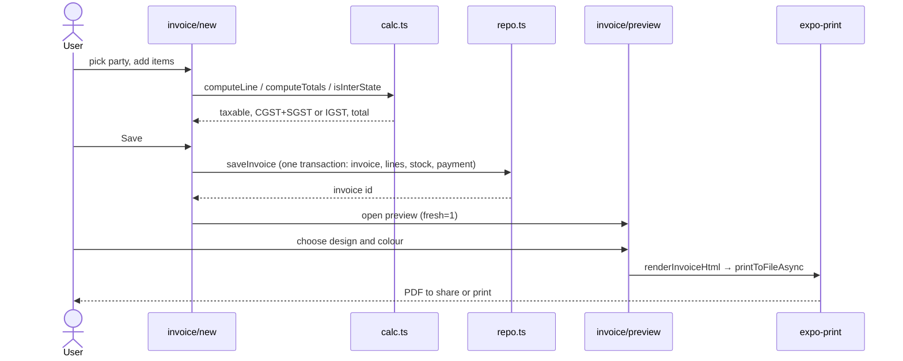
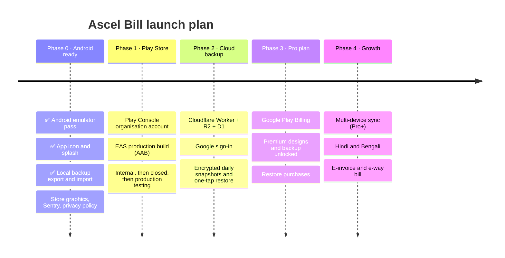

<p align="center">
  
</p>

<p align="center">
  
  
  
  
  
</p>

<p align="center">
  <b>Ascel Bill</b> is a GST billing app for Indian shops and small businesses, built by <b>Ascelstack</b>.<br/>
  You can make an invoice, share the PDF on WhatsApp and record the payment in under a minute, even without internet.
</p>

---

## Contents

1. [Aim](#aim)
2. [Screens](#screens)
3. [What the app does](#what-the-app-does)
4. [Tech stack](#tech-stack)
5. [Architecture](#architecture)
6. [Code map](#code-map)
7. [How the key parts work](#how-the-key-parts-work)
8. [Design system](#design-system)
9. [Getting started](#getting-started)
10. [Team workflow](#team-workflow)
11. [Roadmap and launch plan](#roadmap-and-launch-plan)
12. [Pricing plan](#pricing-plan)

---

## Aim

Most small sellers in India still bill on paper or in WhatsApp chats. The apps that already exist are powerful, but they cost ₹4,000 or more a year and have crowded screens. Ascel Bill aims to fix that with:

- **Fast, simple billing.** A shopkeeper should be able to make a correct GST invoice without training.
- **Offline first.** Every record lives on the phone, so billing works in a basement shop with no signal.
- **Professional output.** Eight invoice designs, plus your logo, signature, bank details and a UPI QR code on every bill.
- **A fair price.** The core app is free forever with no ads on invoices. A low-cost Pro plan adds premium designs and cloud backup.

## Screens

<p align="center">
  
  
  
  
</p>
<p align="center"><sub>Home dashboard · Parties with balances · Invoice detail · Design picker (Noir Luxe)</sub></p>

## What the app does

| Area | What a user can do |
|---|---|
| **Home** | See this month's sales against last month, a six-month chart, what to collect and pay, low stock, and recent bills. Quick actions are one tap away. |
| **Invoices** | Create sale invoices, estimates and purchases. An estimate converts into a sale in one tap. Per-line GST, discount, shipping, round-off and the amount in words in Indian numbering. |
| **Designs** | Choose from 8 templates: Meridian, Noir Luxe, Atelier, Ledger GST, Slate Split, Tidal, Swiss Mono and Thermal 80 mm. Each has colour palettes and a live preview. You can save a design as the default. |
| **Share and print** | Share the PDF to any app, send a WhatsApp payment reminder, or print. |
| **Parties** | Customers and suppliers with running balances ("You'll get" and "You'll give"), and a ledger statement PDF. |
| **Items** | Products and services with HSN codes, GST rate, sale and purchase price, and stock that updates on every sale or purchase. Low-stock alerts. |
| **Payments** | Payment in and out, partial payments, and invoice status (paid, partial or unpaid) updated automatically. |
| **Expenses** | Expenses grouped by category, included in profit. |
| **Backup** | Save every record to one backup file (Drive, Files, WhatsApp) and restore it on any phone, including from the welcome screen of a fresh install. |
| **Reports** | Profit estimate, sales by party, sales by item, and GST by rate for a chosen period. |
| **Business profile** | Logo, GSTIN, state, address, bank and UPI details, a drawn signature, invoice prefix and terms. |

## Tech stack

| Layer | Choice | Why |
|---|---|---|
| App framework | **Expo SDK 58**, React Native 0.88, React 19.3 | One codebase for Android and iOS, cloud builds with EAS, and over-the-air updates. |
| Language | **TypeScript 6** (strict) | Safer refactors as the team grows. |
| Navigation | **Expo Router** (file-based, typed routes) | Every file in `src/app` is a screen, and deep links work for free. |
| Data | **expo-sqlite** | Fast, offline and private. Schema migrations are keyed on `PRAGMA user_version`. |
| PDF | **expo-print** + HTML templates, **expo-sharing** | The same HTML gives the live preview (WebView) and the PDF. |
| Graphics | **react-native-svg** | Charts, brand mark and signature pad. |
| UPI QR | **qrcode-generator** | Builds `upi://pay` QR codes inside the invoice. |
| Fonts | **Inter Tight** (one family) | Clean, readable numbers. |
| Feel | expo-haptics, expo-blur, expo-linear-gradient | Small touches that make the app feel premium. |
| Quality | ESLint (`eslint-config-expo`), `tsc --noEmit` | Run both before every push. |
| **Planned backend** | Cloudflare Workers + R2 + D1 | Paid cloud backup at very low cost. See the [roadmap](#roadmap-and-launch-plan). |

## Architecture

The app has no server today. Every screen reads and writes a local SQLite database through one repository module. Invoices become PDFs on the device itself.



### How an invoice is made



## Code map

```
src/
├── app/                      # Screens (Expo Router). Every file is a route.
│   ├── _layout.tsx           # Fonts, SQLite provider, stack navigator
│   ├── welcome.tsx           # First run: set up a business or load sample data
│   ├── (tabs)/               # Bottom tabs: Home, Parties, ＋, Items, More
│   ├── invoice/              # new.tsx (editor), [id].tsx (detail), preview.tsx (designs + share)
│   ├── party/  item/         # Create, edit and detail screens
│   ├── payment.tsx           # Payment in and out
│   ├── expenses.tsx          # Expense list and add
│   ├── reports.tsx           # Profit, party, item and GST reports
│   ├── business.tsx          # Business profile, bank/UPI, signature
│   └── settings.tsx          # Prefix, terms, default design, data reset
├── components/
│   ├── ui.tsx                # UI kit: T (text), Button, Card, Field, Badge, Screen, Row ...
│   ├── InvoiceCard.tsx       # Invoice list row
│   ├── MiniBars.tsx          # Six-month sales chart (SVG)
│   └── SignaturePad.tsx      # Finger-drawn signature (SVG path)
├── db/
│   ├── schema.ts             # Tables + migrations (PRAGMA user_version)
│   ├── repo.ts               # Every SQL query lives here
│   ├── backup.ts             # JSON backup export / restore (one transaction)
│   ├── seed.ts               # "Explore with sample data" demo shop
│   └── types.ts              # Row and domain types
├── lib/
│   ├── theme.ts              # Colours, fonts, radius, shadow tokens
│   ├── calc.ts               # GST and totals maths
│   ├── format.ts             # Money (Indian grouping), dates, amount in words
│   ├── pdf.ts                # savePdf, share, print, WhatsApp reminder
│   └── hooks.ts              # useData: load on focus, reload on change
└── templates/
    ├── index.ts              # The 8 invoice designs + renderInvoiceHtml
    ├── shared.ts             # Shared HTML parts: QR, tax table, words, signature
    └── statement.ts          # Party ledger statement PDF
```

**Rule of thumb:** screens never write SQL. Add a function to `src/db/repo.ts` and call it from the screen.

### Database tables

`business` (one row) · `parties` · `items` · `invoices` (sale, estimate or purchase) · `invoice_items` · `payments` · `expenses`

To change the schema, bump `DATABASE_VERSION` in `src/db/schema.ts` and add a new `if (version < N)` migration step. Never edit an old step, because users already ran it.

## How the key parts work

**GST.** `isInterState(businessState, partyState)` decides the tax type. If both are in the same state, the line tax splits into CGST and SGST (half each). If the states differ, the full amount is IGST. `computeLine` works out the taxable value after discount, and `taxBreakup` groups tax by rate for the invoice footer and the GST report. All money is rounded with `round2`.

**Stock.** Saving a sale reduces item stock and saving a purchase increases it. Editing or deleting an invoice reverses its old effect first. All of this happens inside one SQLite transaction in `repo.ts`.

**Balances.** A party's balance is opening balance + sales − purchases ± payments. "You'll get" is money the party owes you and "You'll give" is money you owe them.

**Templates.** Each design is a function that returns a full HTML page. The same HTML is shown in the WebView preview and printed to PDF, so what you see is what you share. A template declares its palettes, its format (A4 or thermal) and whether it is premium.

**PDF files.** Always create PDFs through `savePdf` in `src/lib/pdf.ts`. It asks expo-print for base64 and writes the file into the app's own cache, because Android (in Expo Go) refuses to share expo-print's raw output path.

**Backup.** `src/db/backup.ts` writes every table to one versioned JSON file (`app`, `format`, `schema`, `tables`). Restore deletes and re-inserts all rows inside one exclusive transaction, so a failed restore leaves data untouched. Columns the current schema doesn't know are skipped, so older backups still restore. The planned Pro cloud backup will upload this same snapshot, encrypted.

**Data loading.** `useData(loader, deps)` runs the loader when a screen gains focus, so lists are always fresh after you come back from an editor.

## Design system

| Token | Value | Used for |
|---|---|---|
| `ink` | `#1D2D3D` | Primary text, dark buttons, active tab |
| `inkDeep` | `#142130` | Hero cards, preview background |
| `inkRaised` | `#23374B` | Chips and buttons on dark surfaces |
| `accent` | `#5980A6` | Links, focus, the current chart bar |
| `tint` | `#94BCE3` | Labels on dark surfaces, soft highlights |
| `paper` | `#F2F2F3` | App background |

- **Type.** Use Inter Tight only, through the `<T v="...">` component (`display`, `title`, `h2`, `h3`, `body`, `label`, `small`, `eyebrow`, `mono`). Money uses tabular numbers so columns line up.
- **Tone.** Use plain sentence case. Avoid ALL-CAPS labels, jargon and decorative fonts. Write labels a shopkeeper understands, such as "You'll get" rather than "Receivables".
- **Spacing.** Use a 16 px screen gutter and the card radius from `radius` in `theme.ts`.
- **New colours or sizes** go in `src/lib/theme.ts`, never hard-coded in a screen.

## Getting started

Requirements: Node 20+, and either the iOS Simulator (Xcode) or an Android emulator. Expo Go on a real phone also works.

```bash
git clone https://github.com/ASCEL6251/ASCELBILLAPP.git
cd ASCELBILLAPP
npm install
```

```bash
npx expo start          # press i for iOS, a for Android, or scan the QR with Expo Go
```

On first launch, tap **Explore with sample data** to load a demo shop with parties, items, invoices, an estimate, a purchase, payments and expenses.

To keep RAM low, run one simulator and close Android Studio after the emulator boots. Expo Go needs no native build.

### Checks (run before every push)

```bash
npx expo lint
```

```bash
npx tsc --noEmit
```

Deep links help with testing. With Metro running, `exp://127.0.0.1:8081/--/parties` opens the Parties tab in the simulator.

## Team workflow

1. **Branch from `main`** using `feat/<short-name>`, `fix/<short-name>` or `docs/<short-name>`.
2. **Keep the rules:** routes stay in `src/app`, SQL stays in `src/db/repo.ts`, and tokens stay in `src/lib/theme.ts`.
3. **Add packages** with `npx expo install <pkg>` (never `npm i`), so versions match the SDK.
4. **Do not commit `ios/` or `android/`.** They are generated. Configure native settings in `app.json` or a config plugin.
5. **Run lint and typecheck**, then open a pull request with a screenshot of any UI change.
6. **Changing the schema?** Add a migration step and test on a phone that already has data.

## Roadmap and launch plan



| Phase | Done when |
|---|---|
| **0. Android ready** | Every screen works on a mid-range Android phone. The app has a real icon. Data can be exported and imported as a file. |
| **1. Play Store** | The app is live in production on Google Play, with a privacy policy and Data Safety form filled in. |
| **2. Cloud backup** | A Pro user can back up, reinstall, sign in and restore every record. |
| **3. Pro plan** | Paying through Play unlocks Pro on all of the user's devices, and the plan renews and lapses correctly. |
| **4. Growth** | Multi-device sync, more languages and government e-invoice support. |

**Backup design (Phase 2).** The app compresses a SQLite snapshot and encrypts it with a per-user key. That key is wrapped by a master key held only as a Worker secret. The Worker hands out short-lived presigned R2 URLs, so the file never passes through our code. D1 stores users, plans and the backup index. We keep 7 daily and 12 monthly snapshots, plus 30 days after a plan lapses. At launch scale, the cost stays within the free tiers.

## Pricing plan

| Plan | Price | Includes |
|---|---|---|
| **Free** | ₹0, forever | Unlimited invoices, parties, items, reports and 4 designs. No ads on invoices. |
| **Pro** | ₹399/year or ₹49/month | All 8 designs, cloud backup and restore, and priority support |
| **Pro+** *(later)* | ₹799/year | Everything in Pro, plus multi-device sync |

For comparison, a leading competitor charges ₹3,799 to ₹4,799 a year for desktop or desktop-plus-mobile plans.

---

<p align="center"><sub>Made in India by <b>Ascelstack</b> · © 2026 Ascelstack. All rights reserved. Proprietary and confidential; see <a href="LICENSE">LICENSE</a>.</sub></p>
